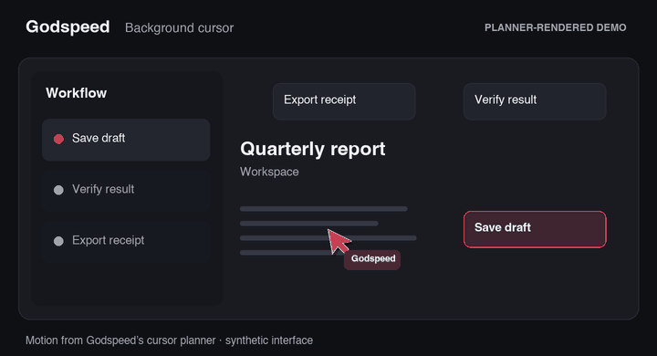

<p align="center"></p>
<h1 align="center">Godspeed</h1>
<p align="center">Background computer use for macOS and Chrome.<br>Accessibility-first desktop automation for Codex, Claude Code, and other MCP clients.</p>


Godspeed reads controls, runs related actions in batches, and checks what changed. Its background launcher protects your focus and keeps your physical pointer free.

<p align="center">
  <a href="https://github.com/fortun8te/godspeed/releases/tag/v1.1.12"><strong>Download for Apple Silicon</strong></a>
  · <a href="docs/INSTALL.md">Setup guide</a>
  · <a href="docs/benchmarks.md">Benchmarks</a>
  · <a href="CHANGELOG.md">Changelog</a>
</p>



*Motion rendered from the production cursor planner.* [Watch the 12-second setup walkthrough](https://github.com/fortun8te/godspeed/releases/download/v1.1.12/setup-walkthrough.mp4).

## Install

**Apple Silicon · macOS 14 or later.** The app is a development preview with ad hoc signing. [Permissions and signing guide](docs/INSTALL.md#signing-and-permissions)

```sh
curl -fLO https://github.com/fortun8te/godspeed/releases/download/v1.1.12/install-godspeed.sh && bash install-godspeed.sh
```

1. Open **GODSPEED.app** from `~/Applications` and follow the permission screen.
2. Connect your MCP client and start a fresh session.

   ```sh
   # Codex
   codex mcp add godspeed -- "$HOME/.local/bin/godspeed-mcp"

   # Claude Code
   claude mcp add --scope user godspeed -- "$HOME/.local/bin/godspeed-mcp"
   ```

3. Ask your agent to read a disposable Calculator window before trying an action.

[Check the connection](docs/INSTALL.md#first-mcp-check) · [Set up Chrome](docs/INSTALL.md#chrome-setup) · [Build from source](docs/INSTALL.md#build-from-source)

## How it works

- **Read the current target.** Native tools use macOS Accessibility data. Query by label for a small result, or read the window when you need the surrounding controls. Screenshots and visual targeting are available with Screen Recording permission.
- **Send related steps in one batch.** Bind actions to the observed window or control, then set a visible result to check with `done_when`. A compact reply can keep only the information needed for the next decision. Detailed recovery receipts stay available when input delivery is uncertain.
- **Check before continuing.** Godspeed separates action dispatch from evidence that the action worked. Resume tokens keep unfinished native steps tied to their saved window and preserve the original step numbers across repeated resumes.
- **Give each agent a visible cursor.** The software cursor shows where a client is working. Client names and cursor effects are configurable. The [tool guide](docs/GODSPEED.md#cursor-and-client-names) explains naming, visual feedback, and background limits.
- **Use local decisions when needed.** The optional GSD1 helper exposes Action, Read, and Recover as advisory models through `local_decision`. They share one tuned checkpoint slot. Godspeed’s tool checks still govern dispatch and verification. [Model setup](experiments/LocalHelper/README.md) · [GSD1 adapter weights](https://github.com/fortun8te/godspeed/releases/tag/gsd1-v0.1.0)

## Examples

| Ask your agent | Godspeed uses |
| --- | --- |
| “Multiply 1234 by 56 in Calculator and verify the display.” | A native batch and a checked result |
| “Read the headings of these public pages in Chrome.” | The browser bridge and a bounded parallel read |
| “Move the selected control to the marked position in this window, then check the result.” | A targeted drag and a separate outcome check |

The default trajectory logs record timings and outcome metadata locally. See the [trace controls](docs/GODSPEED.md#local-traces) for content logging and what to review before sharing a trace.

See [benchmarks](docs/benchmarks.md) for reproducible payload measurements and the public CUA Driver, Codex Computer Use, and Aside comparison. Godspeed’s internal fixtures have a different workload from that public suite.

## Project

[Releases](https://github.com/fortun8te/godspeed/releases) · [Installation](docs/INSTALL.md) · [Tool guide](docs/GODSPEED.md) · [Changelog](CHANGELOG.md) · [Issues](https://github.com/fortun8te/godspeed/issues)

Godspeed’s app source is [MIT-licensed](LICENSE) and based on [Open Computer Use](https://github.com/iFurySt/open-computer-use). GSD1 model weights use the LFM Open License v1.0. [Third-party notices](THIRD_PARTY_NOTICES.md)
