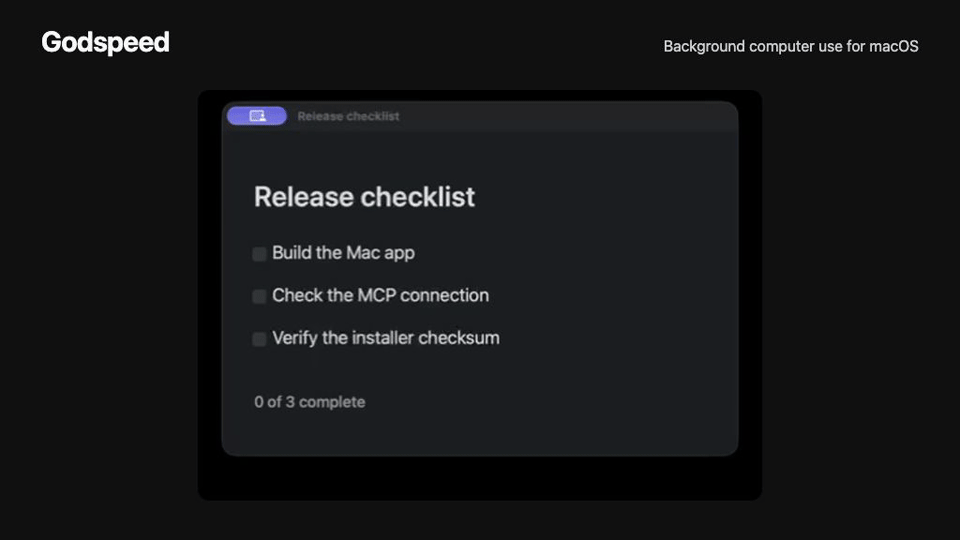

<p align="center"></p>
# Godspeed · Background computer use for macOS

Godspeed is an open-source Model Context Protocol (MCP) server for Mac app and Chrome automation. Codex, Claude Code, and other local MCP clients can read controls, run actions in the background, and verify the result. Godspeed draws its own cursor so your physical pointer stays free on supported background routes.

<p align="center">
  <a href="https://github.com/fortun8te/godspeed/releases/tag/v1.1.12"><strong>Download for Apple Silicon</strong></a>
  · <a href="docs/INSTALL.md">Setup guide</a>
  · <a href="docs/benchmarks.md">Benchmarks</a>
  · <a href="CHANGELOG.md">Changelog</a>
</p>



## Install

**Apple Silicon · macOS 14 or later.** The app is a development preview with ad hoc signing. [Permissions and signing guide](docs/INSTALL.md#signing-and-permissions)

```sh
curl -fLO https://github.com/fortun8te/godspeed/releases/download/v1.1.12/install-godspeed.sh && bash install-godspeed.sh
```

1. Open **GODSPEED.app** from `~/Applications` and follow the permission screen.
2. Connect your MCP client and start a fresh session.

   ```sh
   # Codex
   codex mcp add godspeed -- "$HOME/.local/bin/godspeed-mcp"

   # Claude Code
   claude mcp add --scope user godspeed -- "$HOME/.local/bin/godspeed-mcp"
   ```

3. Ask your agent to read a disposable Calculator window before trying an action.

[Check the connection](docs/INSTALL.md#first-mcp-check) · [Set up Chrome](docs/INSTALL.md#chrome-setup) · [Build from source](docs/INSTALL.md#build-from-source)

## How Godspeed works

1. **Read the app or tab.** Mac apps expose named controls through macOS Accessibility. Chrome uses the optional extension bridge to read page controls. Ask for just one control, a compact window read, or a screenshot when the UI needs it.
2. **Run a batch.** Send related actions together. Native steps can bind to a window Godspeed has already observed. The on-screen software cursor shows where the agent is working, including on a different display.
3. **Verify and recover.** Give the batch an expected result with `done_when`. Godspeed distinguishes whether an action was sent from whether the result appeared. Unfinished native steps can be resumed against their saved window.

The optional GSD1 Action, Read, and Recover models score choices on Apple Silicon. They advise the caller. Ordinary reads, exact control actions, and deterministic checks can run without model inference. The driver keeps timing and action outcomes in [local traces](docs/GODSPEED.md#local-traces). The current source also records model activity by role. [Model setup](experiments/LocalHelper/README.md) · [Adapter weights](https://github.com/fortun8te/godspeed/releases/tag/gsd1-v0.1.0)

## When to use it

Use Godspeed when an agent needs to operate an existing Mac app or Chrome tab while you keep using the Mac. Named controls often give the agent enough context to act without passing a full screenshot on each step. In a reproducible 80-control fixture, an explicitly compact batch with a verified result returned **105 bytes of tool text**, compared with **1,959 bytes** for the full reply. That measures reply size. A matched run is still needed to compare task success, speed, and model tokens against other tools. [Benchmark methods and results](docs/benchmarks.md)

Some apps expose limited controls. Chrome extension overlays and native file pickers can also block a background route. Godspeed reports incomplete or uncertain steps so the client can check the current state before retrying.

## Can it run while my Mac is locked?

The public build requires an awake, unlocked desktop for app controls, Chrome, and screenshots. The MCP server can still answer discovery requests while the Mac is awake and the server is running.

## Examples

| Ask your agent | Godspeed uses |
| --- | --- |
| “Multiply 1234 by 56 in Calculator and verify the display.” | A native batch and a checked result |
| “Read the headings of these public pages in Chrome.” | The browser bridge and a bounded parallel read |
| “Move the selected control to the marked position in this window, then check the result.” | A targeted drag and a separate outcome check |

## Project

[Releases](https://github.com/fortun8te/godspeed/releases) · [Installation](docs/INSTALL.md) · [Tool guide](docs/GODSPEED.md) · [Changelog](CHANGELOG.md) · [Issues](https://github.com/fortun8te/godspeed/issues) · [MCP Registry](https://registry.modelcontextprotocol.io/v0.1/servers?search=io.github.fortun8te%2Fgodspeed)

Godspeed’s app source is [MIT-licensed](LICENSE) and based on [Open Computer Use](https://github.com/iFurySt/open-computer-use). GSD1 model weights use the LFM Open License v1.0. [Third-party notices](THIRD_PARTY_NOTICES.md)
